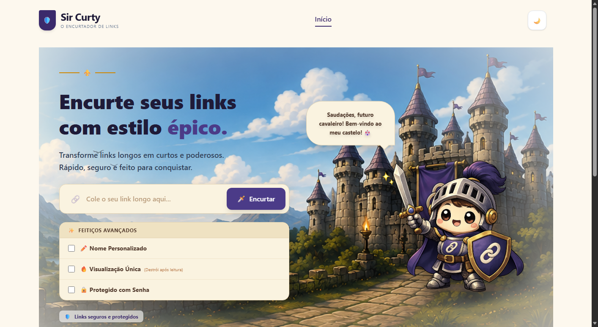
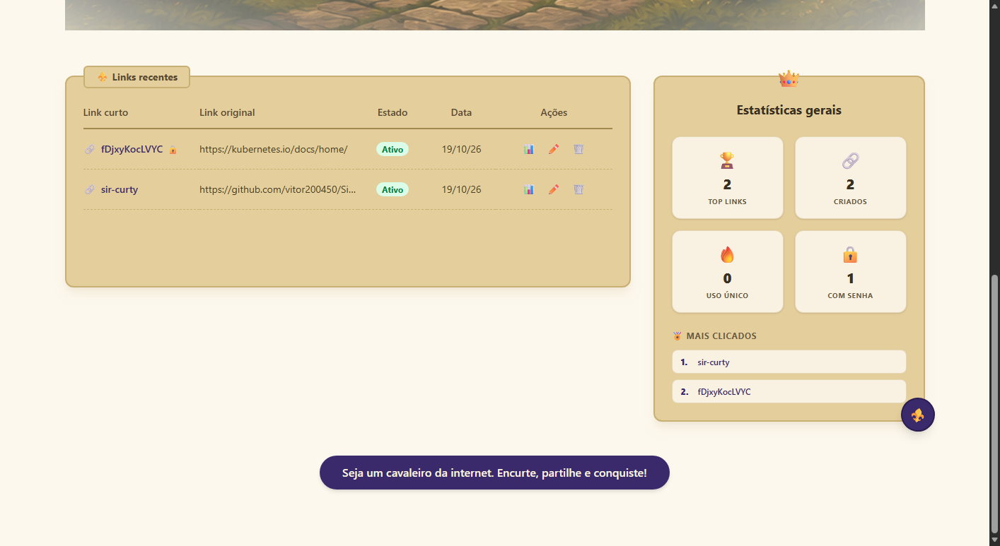
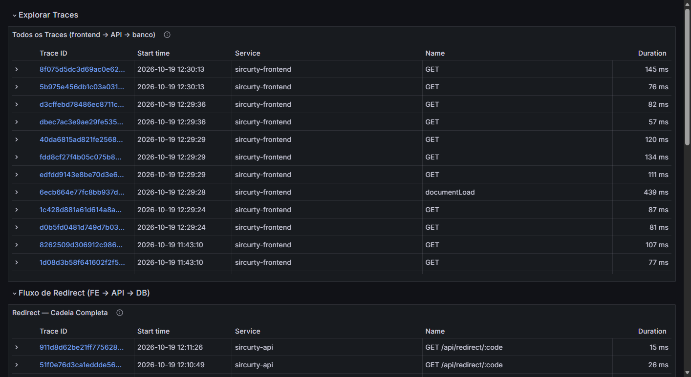
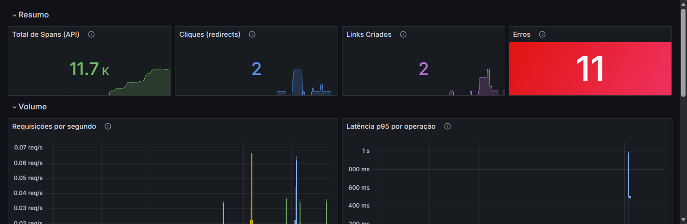
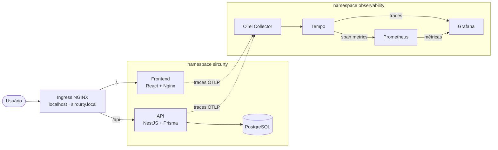
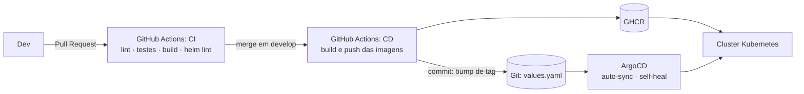

<div align="center">


<p></p>

<p></p>

**O encurtador de links cloud-native que fatia links-monstro com uma espada mágica.**

[](https://github.com/vitor200450/SirCurty/actions/workflows/ci.yml)
[](https://github.com/vitor200450/SirCurty/actions/workflows/cd.yml)


**Squad 4** · Hackathon Cloud-Native · AWS AI FDE CloudOps Journey (turma MAI26)

[Sobre](#sobre-o-projeto) · [Funcionalidades](#funcionalidades) · [Telas](#telas) · [Arquitetura](#arquitetura) · [Como rodar](#como-rodar) · [Equipe](#equipe)

</div>

---

## Sobre o projeto

Links longos, confusos e perigosos assumem a forma de monstros e bestas terríveis. É aí que entra **Sir Curty**: com sua espada mágica ele fatia essas criaturas, transforma URLs gigantes em atalhos inofensivos e usa o escudo para manter tudo seguro. O encurtador é o reino que ele jurou proteger.

Por trás da brincadeira há uma plataforma completa para **encurtar, organizar e monitorar links**, com estatísticas de acesso e uma infraestrutura cloud-native de ponta a ponta: frontend, API e banco rodando em Kubernetes, entregues por CI/CD e GitOps, com traces distribuídos do navegador até o banco e dashboards no Grafana.

- **Tema:** medieval moderno e amigável, em azul, púrpura e dourado.
- **Personalidade:** animado, destemido e carismático; tom de voz simples e amigável.
- **Público:** quem quer gerenciar seus links sem complicação.

## Funcionalidades

| | Funcionalidade | Como funciona |
|---|---|---|
| ✂️ | **Encurtar links** | Códigos curtos em Base62, não sequenciais. |
| 🏷️ | **Nome personalizado** | Defina o próprio código (vanity URL); códigos repetidos são recusados. |
| 🔒 | **Proteção por senha** | O destino só abre depois de informar a senha correta. |
| 🔥 | **Uso único** | O link é "destruído" depois da primeira leitura. |
| ⏳ | **Expiração** | Links com data de validade; depois dela, a página de link expirado. |
| 🛡️ | **Aviso antes de redirecionar** | Tela intermediária mostra para onde o link leva, com contagem 3-2-1. |
| 👤 | **Sem cadastro, com login opcional** | Links criados como anônimo (cookie) migram para a conta ao entrar com o Google. |
| 📊 | **Dashboard** | Listar, editar, excluir, ver estatísticas por link, ranking dos mais clicados e totais gerais. |
| 🏰 | **Páginas temáticas** | Telas próprias para link consumido, expirado, desativado e não encontrado. |
| 🚦 | **Rate limit** | Limite de requisições por janela de tempo na API. |

## Telas

<p align="center"><br><sub>Início: encurtar um link, com os "feitiços avançados" (nome, uso único, senha)</sub></p>

<p align="center"><br><sub>Links recentes e estatísticas gerais</sub></p>

<p align="center"><br><sub>Link de uso único já consumido</sub></p>

<p align="center"><br><sub>Traces distribuídos (frontend → API → banco) no Grafana</sub></p>

<p align="center"><br><sub>Visão geral no Grafana: spans, cliques, links criados, erros, requisições por segundo e latência p95</sub></p>

## Arquitetura



**Pipeline de entrega (CI/CD + GitOps):**



| Camada | Tecnologias |
|---|---|
| Frontend | React, Vite, TypeScript, React Query |
| API | NestJS, TypeScript, Prisma, class-validator |
| Banco | PostgreSQL 16 |
| Contêineres e orquestração | Docker, Kubernetes (Docker Desktop), Helm |
| CI/CD e GitOps | GitHub Actions, GHCR, ArgoCD |
| Observabilidade | OpenTelemetry (navegador e API), Tempo, Prometheus, Grafana |

O Git é a fonte da verdade do cluster: o ArgoCD só aplica o que está commitado, e o `self-heal` recria sozinho qualquer recurso apagado. Detalhes em [`docs/infrastructure.md`](docs/infrastructure.md) e [`docs/observability.md`](docs/observability.md).

## Estrutura do repositório

```text
SirCurty/
  frontend/            # SPA React + Vite + TypeScript (Nginx serve o build)
  api/                 # API NestJS + Prisma
  k8s/                 # chart Helm (app + observabilidade) e Application do ArgoCD
  .github/workflows/   # CI e CD (GitHub Actions)
  docs/                # planejamento, infraestrutura, observabilidade, pitch, uso de IA
```

## Como rodar

Duas formas de subir o projeto. A **A** é o ambiente da demo; a **B** serve para desenvolver sem Kubernetes.

### A. Cluster local (Docker Desktop + Kubernetes + ArgoCD)

Pré-requisitos: Docker Desktop com **Kubernetes habilitado**, `kubectl` e `helm`. Detalhes e comandos completos em [`k8s/README.md`](k8s/README.md).

1. Instale o Ingress NGINX:
   ```bash
   kubectl apply -f https://raw.githubusercontent.com/kubernetes/ingress-nginx/main/deploy/static/provider/cloud/deploy.yaml
   ```
2. Adicione ao arquivo hosts (no Windows, `C:\Windows\System32\drivers\etc\hosts`, como administrador):
   ```text
   127.0.0.1 sircurty.local grafana.sircurty.local otel.sircurty.local
   ```
3. Crie o Secret (nunca vai para o git; o `GOOGLE_CLIENT_ID` é o mesmo do `.env` local):
   ```bash
   kubectl create namespace sircurty
   kubectl -n sircurty create secret generic sircurty-secrets \
     --from-literal=POSTGRES_PASSWORD='<senha>' \
     --from-literal=DATABASE_URL='postgresql://sircurty:<senha>@postgres:5432/sircurty?schema=public' \
     --from-literal=JWT_SECRET='<string-aleatoria>' \
     --from-literal=GOOGLE_CLIENT_ID='<id>.apps.googleusercontent.com'
   ```
4. Suba a aplicação. Com ArgoCD (GitOps, o caminho usado na demo): instale o ArgoCD e rode `kubectl apply -f k8s/argocd/application.yaml`. Sem ArgoCD:
   ```bash
   helm upgrade --install sircurty k8s/charts/sircurty --namespace default
   ```
5. Confira: `kubectl get pods -A` (tudo `Running`) e, com ArgoCD, `kubectl -n argocd get application sircurty-dev` em `Synced`/`Healthy`.

Endereços:

| URL | O que é |
|---|---|
| `http://localhost` | App, com login do Google (a origem `http://localhost` é a registrada no Google Cloud) |
| `http://sircurty.local` | App (alias), só fluxo anônimo: o Google recusa origens `.local` |
| `http://grafana.sircurty.local` | Grafana. Para abrir o detalhe de um trace (Explore), entre como `admin` / `sircurty` (credencial de dev do chart) |

Os checks de saúde da API ficam em `/health/live` e `/health/ready` (via `kubectl -n sircurty port-forward svc/api 3000:3000`).

### B. Desenvolvimento sem Kubernetes

Pré-requisitos: Node.js e um PostgreSQL acessível pela `DATABASE_URL`. Os comandos abaixo vêm dos scripts do `package.json` e dos arquivos `.env.example`; o projeto não traz um `docker-compose`.

```bash
# banco (exemplo com Docker, usando os valores do api/.env.example)
docker run --name sircurty-db -e POSTGRES_USER=sircurty -e POSTGRES_PASSWORD=changeme \
  -e POSTGRES_DB=sircurty -p 5432:5432 -d postgres:16-alpine

# API (porta 3000)
cd api
cp .env.example .env          # preencha GOOGLE_CLIENT_ID
npm ci
npm run prisma:generate
npm run prisma:migrate:deploy
npm run start:dev

# frontend (porta 5173, proxy de /api para a porta 3000)
cd frontend
cp .env.example .env.development   # preencha VITE_GOOGLE_CLIENT_ID
npm ci
npm run dev
```

Testes e checagens:

```bash
cd api && npm test            # jest
cd frontend && npm run lint && npm run build   # o frontend não tem testes automatizados
helm lint k8s/charts/sircurty && helm template sircurty k8s/charts/sircurty > /dev/null
```

## Documentação

| Documento | Conteúdo |
|---|---|
| [`docs/initial-planning.md`](docs/initial-planning.md) | Conceito, identidade, escopo e decisões do squad |
| [`docs/infrastructure.md`](docs/infrastructure.md) | Kubernetes, CI/CD e GitOps |
| [`docs/observability.md`](docs/observability.md) | OpenTelemetry, Tempo, Prometheus e dashboards |
| [`docs/git-workflow.md`](docs/git-workflow.md) | Fluxo de branches e responsabilidades |
| [`docs/manual-e2e-checklist.md`](docs/manual-e2e-checklist.md) | Roteiro de teste manual de ponta a ponta |
| [`docs/pitch.md`](docs/pitch.md) | Roteiro do pitch, demo ao vivo e plano B |
| [`docs/ai-usage.md`](docs/ai-usage.md) | Como a IA foi usada: prompts, decisões e limites |
| [`k8s/README.md`](k8s/README.md) | Chart Helm e como aplicá-lo |

## Equipe

**Squad 4** · projeto final da formação **AWS AI FDE CloudOps Journey (turma MAI26)**, promovida pela **AIR Academy** e pelo **Innovation Studio Cloud & DevSecOps**, com apoio da **AWS**.

<table>
  <tr>
    <td align="center" width="25%">
      <a href="https://github.com/AlerandroFS"></a><br>
      <b>Alerandro Fernandes dos Santos</b><br>
      <a href="https://github.com/AlerandroFS">@AlerandroFS</a><br>
      <sub>Frontend, identidade visual e UX</sub>
    </td>
    <td align="center" width="25%">
      <a href="https://github.com/devErikyLS"></a><br>
      <b>Eriky Lima Santos</b><br>
      <a href="https://github.com/devErikyLS">@devErikyLS</a><br>
      <sub>API, Prisma e PostgreSQL</sub>
    </td>
    <td align="center" width="25%">
      <a href="https://github.com/vitor200450"></a><br>
      <b>José Vitor do Nascimento Rodrigues</b><br>
      <a href="https://github.com/vitor200450">@vitor200450</a><br>
      <sub>Kubernetes, CI/CD e GitOps</sub>
    </td>
    <td align="center" width="25%">
      <a href="https://github.com/hal2329"></a><br>
      <b>Matheus Alves da Silva</b><br>
      <a href="https://github.com/hal2329">@hal2329</a><br>
      <sub>Observabilidade (OpenTelemetry e Grafana)</sub>
    </td>
  </tr>
</table>

As áreas seguem o planejamento do squad (`docs/initial-planning.md`, seção 7). Na prática, cada integrante também apoiou as outras áreas, como mostram as Pull Requests.

## Como a IA foi usada

A IA atuou como copiloto ao longo do projeto (Kiro e Claude), sempre dentro do fluxo de Pull Requests com revisão do squad. Os prompts, as decisões, os ajustes manuais e os erros da IA estão registrados em [`docs/ai-usage.md`](docs/ai-usage.md).

## Entregáveis

| Entregável | Onde |
|---|---|
| Código, manifests Kubernetes e workflows do GitHub Actions | `frontend/`, `api/`, `k8s/`, `.github/workflows/` |
| Encurtador rodando no cluster via ArgoCD | [Como rodar](#como-rodar) |
| Dashboards do Grafana e traces demonstráveis | [Telas](#telas), [`docs/observability.md`](docs/observability.md) |
| Personagem, identidade e funcionalidades exclusivas | [Sobre](#sobre-o-projeto), [Funcionalidades](#funcionalidades) |
| Pitch de 15 minutos com demo ao vivo | [`docs/pitch.md`](docs/pitch.md) |
| Log de uso de IA | [`docs/ai-usage.md`](docs/ai-usage.md) |
